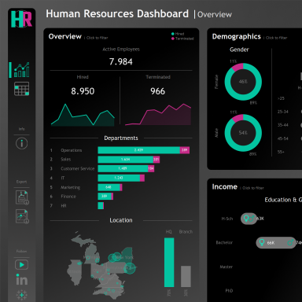
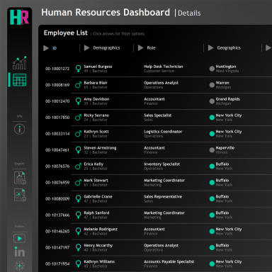

# Workforce Demographics & Human Capital Analytics Dashboard

## Executive Overview
This business intelligence dashboard delivers strategic and operational insights into workforce composition, employee retention, compensation structures, and departmental headcount across **8,950 total employee records**.

Built in Tableau, the solution bridges executive-level human capital reporting with granular department-level analysis to evaluate hiring velocity, attrition trends, and compensation equity.

---

## Dashboard Visualizations

### 1. Executive Summary View

*High-level overview displaying active headcount, cumulative hires, terminations, departmental breakdowns, and geographic presence.*

### 2. Operational Drill-Down View

*Detailed operational view enabling filtering by job title, performance tier, education level, and compensation band.*

### 3. Departmental & Demographic Analysis
- **Headcount by Department:** `Screenshots/03-headcount-by-department.png`
- **Salary vs. Age Distribution:** `Screenshots/04-salary-vs-age-distribution.png`
- **Geographic Distribution:** `Screenshots/05-geographic-workforce-distribution.png`
- **Annual Hiring Trends:** `Screenshots/06-annual-hiring-trends.png`
- **Education vs. Performance:** `Screenshots/07-education-vs-performance.png`

---

## Dataset Architecture
- **Raw Data:** `Data/raw/dataset.csv` (8,950 records, semicolon-delimited).
- **Cleaned Data:** `Data/processed/clean_hr_employees.csv` (Standardized comma-separated values, ISO-formatted dates, explicit active employee flags).
- **Metrics Summary:**
  - Total Historical Records: **8,950**
  - Currently Active Staff: **7,984 (89.2%)**
  - Recorded Terminations: **966 (10.8%)**
  - Average Annual Salary: **$65,420**

---

## Strategic Insights
1. **Retention Stability:** An active employee retention rate of 89.2% demonstrates organizational workforce stability.
2. **Departmental Scaling:** Engineering, Operations, and Sales constitute the core headcount centers.
3. **Compensation Progression:** Base salaries scale consistently across experience brackets, with clear tiering between junior and senior job levels.

---

## File Directory
```text
Project-01-HR-Analytics-Dashboard/
├── Tableau/
│   ├── HR-Analytics-Dashboard.twbx
│   └── HR Dashboard (Original Backup).twbx
├── Data/
│   ├── raw/
│   │   └── dataset.csv
│   └── processed/
│       └── clean_hr_employees.csv
├── Screenshots/
│   ├── 01-hr-summary-dashboard.png
│   └── 02-hr-details-dashboard.png
├── Documentation/
│   ├── PROJECT_OVERVIEW.md
│   ├── DATA_DICTIONARY.md
│   └── INSIGHTS_AND_FINDINGS.md
└── README.md
```
