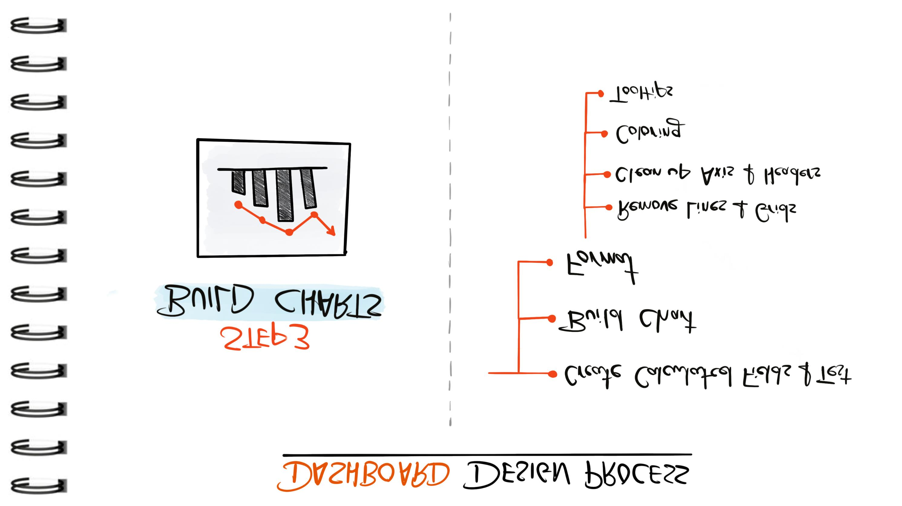
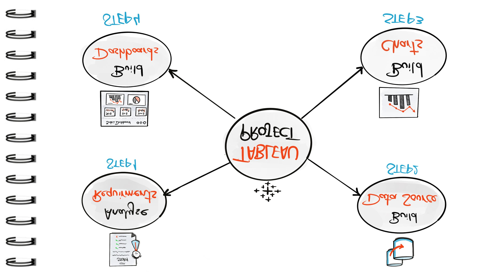
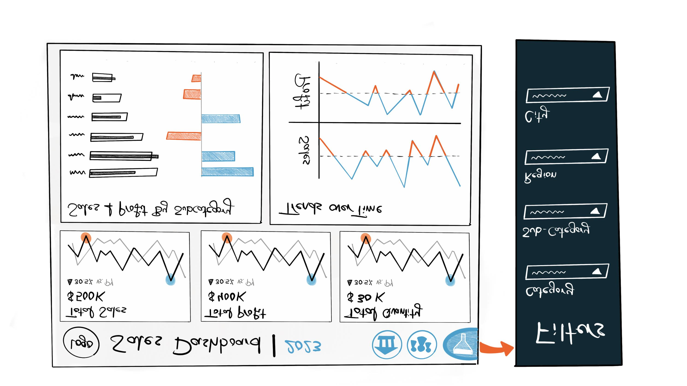
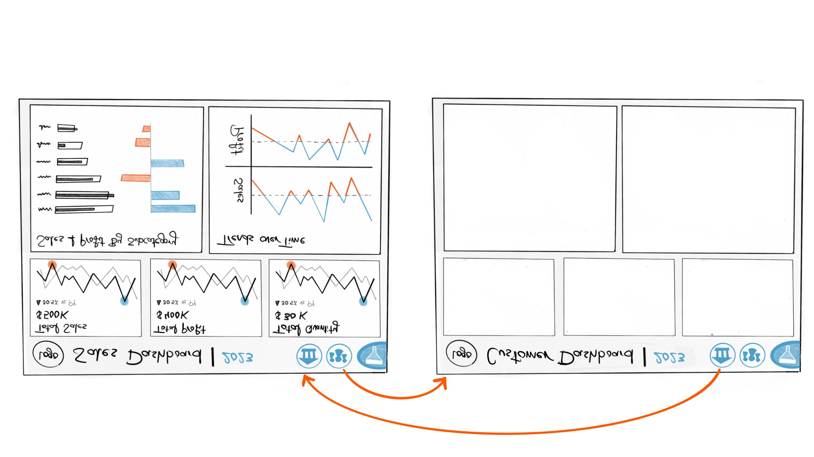
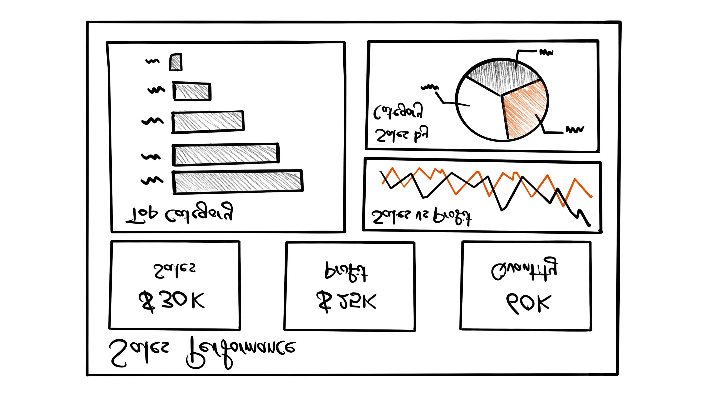

# Executive Sales Performance & Customer Lifetime Intelligence Dashboard

## Executive Summary
This end-to-end commercial analytics suite delivers executive-level revenue visibility, customer lifetime value (LTV) segmentation, geographic margin analysis, and order fulfillment tracking across **10,372 orders** and **793 enterprise accounts**.

Featuring custom UI wireframing, floating navigation menus, dynamic parameter toggles, and unified international data models (merging EU and Non-EU currency/decimal formats), this project models retail sales operations for Chief Commercial Officers (CCOs) and VP of Sales.

---

## Dashboard Previews

### 1. Executive Sales Overview Dashboard


*High-resolution executive cockpit highlighting gross revenue ($2.3M+), operating profit ($286K+), profit margins (12.4%), YoY growth trajectories, and regional revenue maps.*

### 2. Customer Analytics & Retention Dashboard


*Customer cohort analytics, top 10 revenue-generating accounts, discount sensitivity curves, order frequency distributions, and customer segment profitability (Consumer, Corporate, Home Office).*

### 3. UI Design Architecture & Wireframing
| Layout Wireframe & Grid System | Interactive Filter Navigation |
| :---: | :---: |
|  |  |
| **Original Design Blueprint** | **Key Performance Cards** |
|  | *Dynamic BANs with prior-period variance indicators* |

---

## Business Problem & Analytical Objectives
- **Multi-Region Fragmentation:** Sales data collected in disparate formats across European (semicolon/comma decimals) and North American systems.
- **Discount Erosion:** Unchecked discounting eroding operating margins across specific product sub-categories (e.g. Furniture, Binders, Tables).
- **Customer Concentration:** Identifying the top 20% of customer accounts driving 80% of operating profit (Pareto principle).
- **Geographic Arbitrage:** Identifying regions with high top-line revenue but negative net profitability due to excessive logistics costs.

---

## Dataset & Technical Architecture
- **Raw Sources:** `datasets/eu/` and `datasets/non-eu/` (`Orders.csv`, `Customers.csv`, `Location.csv`, `Products.csv`).
- **Unified Clean Mart:** `Data/processed/clean_sales_orders_complete.csv` (10,372 orders, 21 relational attributes).
- **Calculated Fields (33 custom fields):**
  - `Profit Ratio` = `SUM([Profit]) / SUM([Sales])`
  - `YoY Sales Growth` = `(ZN(SUM([Sales])) - LOOKUP(ZN(SUM([Sales])), -1)) / ABS(LOOKUP(ZN(SUM([Sales])), -1))`
  - `Customer Lifetime Value` = `FIXED [Customer ID] : SUM([Sales])`
  - `Discount Bracket` = `IF [Discount] = 0 THEN 'No Discount' ELSEIF [Discount] <= 0.2 THEN 'Low (0-20%)' ELSE 'High (>20%)' END`

---

## Key Business Insights & Findings
1. **Profitability Disconnect:** While Technology generated the highest gross margins (~17.4%), Furniture experienced significant margin compression in several regions due to discounts exceeding 25%.
2. **Customer Pareto Dynamics:** The top 50 corporate accounts generate over 35% of total operating profit, validating a dedicated account management strategy.
3. **Regional Performance:** The Western region consistently outperformed Central in margin retention, primarily driven by superior product category mix and lower shipping cost overhead.

---

## Repository Structure
```text
Project-02-Sales-Customer-Insights/
├── Tableau/
│   ├── Sales-Customer-Dashboards.twbx
│   └── Sales & Customer Dashboards (Original Backup).twbx
├── Data/
│   ├── raw/
│   │   ├── eu/ (Customers.csv, Location.csv, Orders.csv, Products.csv)
│   │   └── non-eu/ (Customers.csv, Location.csv, Orders.csv, Products.csv)
│   └── processed/
│       ├── clean_orders.csv
│       ├── clean_customers.csv
│       ├── clean_products.csv
│       ├── clean_locations.csv
│       └── clean_sales_orders_complete.csv
├── Screenshots/
│   ├── 01-executive-sales-overview-dashboard.png
│   ├── 02-customer-analytics-dashboard.png
│   ├── 03-dashboard-wireframe-and-grid-layout.png
│   ├── 04-filter-menu-and-interactive-navigation.png
│   └── 05-original-design-mockup.png
├── Documentation/
│   ├── PROJECT_OVERVIEW.md
│   ├── DATA_DICTIONARY.md
│   ├── INSIGHTS_AND_FINDINGS.md
│   ├── mockup.pdf
│   └── project_phases.pdf
└── README.md
```
