# India Mutual Fund & Macro-Financialization Intelligence System

## Executive Summary
This enterprise-scale institutional research dashboard provides econometric and quantitative analytics on India's asset management industry, domestic savings financialization, Asset Management Company (AMC) market concentration, benchmark-relative alpha, fixed income yield curves, and Systematic Investment Plan (SIP) resilience during market stress events.

Covering over **48 months of continuous historical time-series data** from the Association of Mutual Funds in India (AMFI), Reserve Bank of India (RBI), and benchmark index providers, this system integrates **7 relational financial data sources**, **24 quantitative worksheets**, and **2 executive dashboards**.

---

## Dashboard Previews

### 1. Industry Financialization & AUM Architecture
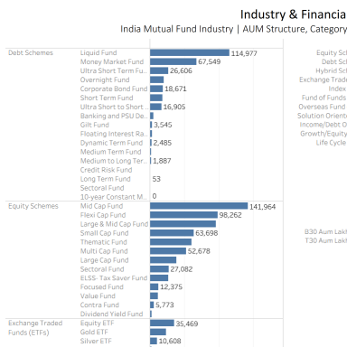

*Executive visualization tracking India's total mutual fund Assets Under Management (AUM) growth, retail vs institutional participation, category transitions (Equity vs Debt vs Hybrid), and geographic penetration (T30 vs B30 cities).*

### 2. Macro Capital Flows & Market Stress Transmission
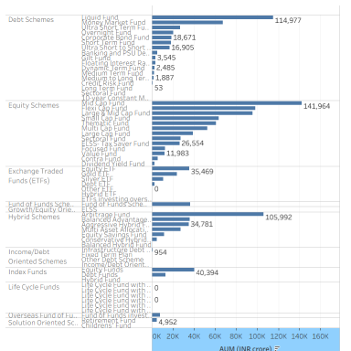

*Macroeconomic intelligence layer linking Foreign Portfolio Investor (FPI) equity flows, domestic mutual fund net mobilization, RBI repo rate regimes, and 10-year G-Sec yield curves.*

### 3. Quantitative Research Modules
| Industry AUM Snapshot | Category Asset Mix | AMC Market Concentration | AMC Rank Stability |
| :---: | :---: | :---: | :---: |
| 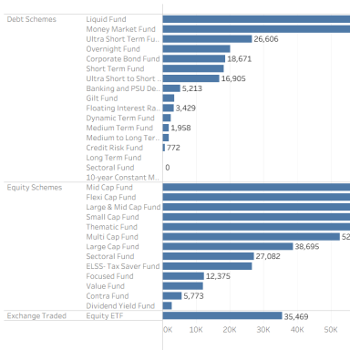 | 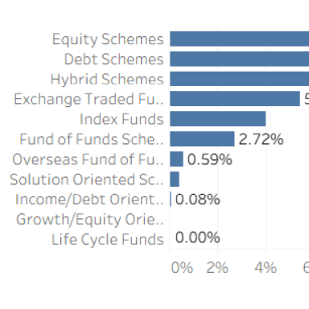 | 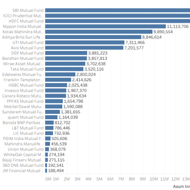 | 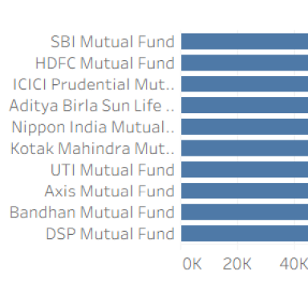 |
| **Fund Return Distributions** | **Risk-Return Profile** | **G-Sec Yield Curve** | **Monetary Debt Regime** |
| 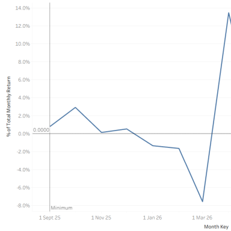 | 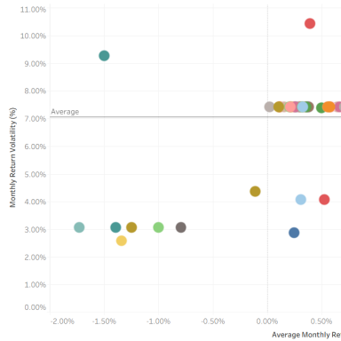 | 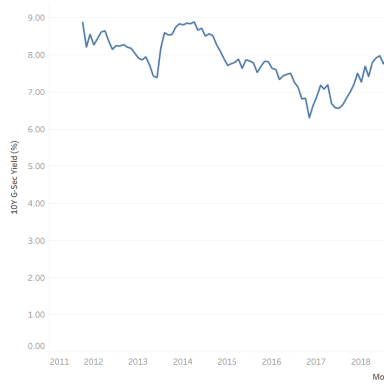 | 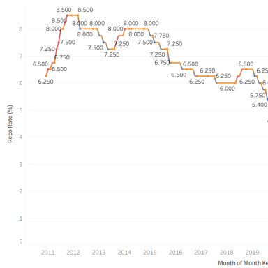 |
| **Net Flow Momentum** | **FPI Capital Transmissions** | **SIP Inflow Trends** | **SIP Stress Resilience** |
| 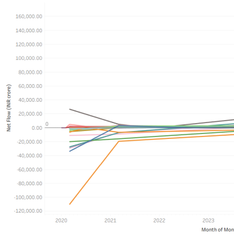 | 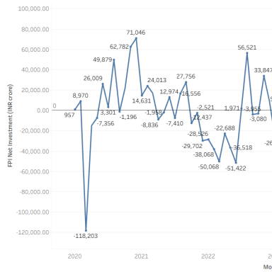 | 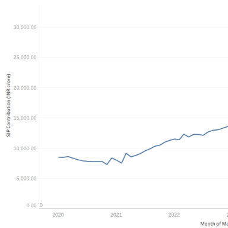 | 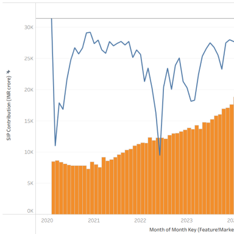 |

---

## Analytical Modules & Research Questions
1. **Industry Growth & Financialization (D1):** Quantifying the structural migration of Indian household balance sheets from physical assets (gold, real estate) into capital market instruments.
2. **Asset Manager Concentration (D2):** Evaluating market dominance using the Herfindahl-Hirschman Index (HHI), Concentration Ratio (CR3, CR5), and quartile rank migrations across top AMCs (SBI, ICICI Prudential, HDFC, Nippon India, Kotak).
3. **Active vs. Passive & Benchmark Alpha (D3):** Analyzing matched 36-month rolling excess returns across Large Cap, Mid Cap, and Small Cap categories versus TRI (Total Return Index) benchmarks.
4. **Interest Rate & Fixed Income Regimes (D4):** Measuring debt fund return sensitivity across rising, plateauing, and easing RBI repo rate cycles.
5. **Macroeconomic Flows & Foreign Capital (D5):** Lagged Pearson/Spearman cross-correlation between foreign institutional flows (FPI) and domestic mutual fund capital mobilization.
6. **SIP Structural Resilience (D6):** Stress testing systematic investment plan flows through severe drawdown windows (e.g. March 2020 COVID shock, 2022 inflation corrections).

---

## Technical Data Architecture
- **Tableau Workbook:** `India-Mutual-Fund-Intelligence.twbx` (Institutional packaged workbook containing multi-tiered extracts).
- **Core Marts:**
  - `DS01_FUND_CORE` — Scheme master directory, category taxonomy, launch dates.
  - `DS02_AMC_COMPETITION` — Quarterly Average AUM (AAUM), market share, AMC rankings.
  - `DS03_FUND_PERFORMANCE` — Scheme NAV time series, 1Y/3Y/5Y CAGR, Sharpe ratio, Max Drawdown.
  - `DS04_DEBT_RATES` — RBI Repo rates, 91-day T-Bill yields, 10-year G-Sec sovereign benchmark curves.
  - `DS05_FLOWS_MACRO` — Monthly gross mobilization, redemptions, net inflows, FPI equity/debt flows, headline CPI, USD/INR.
  - `DS06_SIP_RESILIENCE` — Monthly SIP contribution totals, SIP account counts, stoppage ratios.
  - `D1_INDUSTRY_FINANCIALIZATION` — High-level synthesized annual and quarterly aggregates.

---

## Key Financial Insights & Empirical Findings
1. **Structural Domestic Counter-Weight:** Monthly domestic mutual fund net equity inflows consistently counterbalanced large-scale FPI foreign capital outflows during 2021-2023, decoupling Indian equity valuations from foreign volatility.
2. **SIP Antifragility:** Retail SIP inflows exhibited near-perfect structural inelasticity during market corrections; monthly contributions grew from ~₹8,000 Cr in 2020 to >₹20,000 Cr by 2024 despite periodic macroeconomic headwinds.
3. **AMC Industry Concentration:** The top 5 asset managers control over 55% of industry AAUM, though passive exchange-traded fund (ETF) adoption is driving rapid share gains for tech-enabled low-cost players.
4. **Yield Curve Transmission:** Debt fund durations displayed predictable NAV mark-to-market impacts during RBI tightening regimes, with short-duration and liquid funds serving as liquidity buffers.

---

## Large File Management & Git LFS Note
- **Workbook Size:** `India-Mutual-Fund-Intelligence.twbx` is **145 MB** due to high-frequency historical NAV and flow extracts.
- **GitHub Protocol:** Tracked via Git Large File Storage (`.gitattributes`) to prevent exceeding GitHub's standard 100 MB commit limit. Full details in `docs/GITHUB_SETUP.md`.
