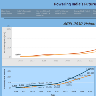
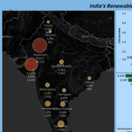
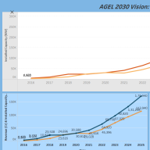

# Powering India’s Future: Adani Green Energy (AGEL) Renewable Transition & 2030 Vision

## Executive Summary
This interactive Tableau visual story documents India's energy transition through the lens of **Adani Green Energy Limited (AGEL)**, Asia's largest renewable energy producer.

The portfolio tracks India's vast renewable resource potential across states, contrasts historical capacity deployment against long-term 2030 national targets (500 GW clean energy by 2030), and maps AGEL's project footprint, solar-wind-hybrid technology mix, generation output (MU), financial revenue trajectory (₹ Cr), and environmental decarbonization (CO2 avoided in MT).

---

## Interactive Dashboard Suite

### 1. Executive Story: Powering India’s Future


*High-level narrative dashboard establishing the national energy transition mandate, contrasting fossil fuel reserves against massive solar/wind endowments.*

### 2. Operational Landscape: India’s Renewable Footprint & AGEL Today


*Geographic and capacity breakdown of operating assets across key renewable corridors in Rajasthan, Gujarat, Tamil Nadu, Karnataka, and Andhra Pradesh.*

### 3. Strategic Outlook: AGEL 2030 Vision & Growth Drivers


*Econometric forecast modeling capacity scaling from ~10 GW towards the 45 GW / 50 GW 2030 corporate milestone, highlighting revenue growth, corporate tax incentives, and decarbonization metrics.*

### 4. Analytical Views & Presentation Evidence
| Renewable Potential Map | Historical Growth Velocity |
| :---: | :---: |
|  |  |
| **Solar vs. Wind Technology Mix** | **Revenue & Generation Correlation** |
|  |  |

---

## Business Problem & Objectives
- **Resource Quantification:** Evaluating state-level renewable potential (MW) versus installed capacity to identify regional development bottlenecks.
- **Technology Evolution:** Tracking the operational transition from standalone solar installations to dispatchable Solar-Wind Hybrid projects.
- **Financial Viability:** Demonstrating how capital expenditure and capacity additions translate into power generation (Million Units) and top-line EBITDA revenue.
- **Climate Impact:** Quantifying avoided carbon emissions (Million Tonnes of CO2) to substantiate ESG commitments.

---

## Dataset & Transformation Architecture
- **Raw Master Source:** `Data/raw/AGEL_Master_OneSheet.xlsx` (180 time-series observations, 26 raw variables spanning 2016 to 2030).
- **Cleaned Dataset:** `Data/processed/clean_agel_master_timeseries.csv` (25 standardized columns, resolving previous merge ambiguities between state-level and national total capacity).
- **Key Columns:**
  - `State Installed Capacity (MW)`: State-level asset footprint.
  - `Total Operational Capacity (MW)`: Company-wide operational capacity.
  - `Solar Capacity (MW)`, `Wind Capacity (MW)`, `Hybrid Capacity (MW)`: Technology breakdown.
  - `Generation_MU`: Annual electricity output in Million Units.
  - `Revenue (Cr)`: Annual revenue from power supply in INR Crores.
  - `CO2 Avoided (MT)`: Avoided greenhouse gas emissions in Million Metric Tonnes.
  - `Is_Historical` / `Is_Forecast`: Chronological horizon segmenter.

---

## Key Business Insights & Analytical Findings
1. **The Western Corridor Dominance:**
   - **Rajasthan (6,155 MW)** and **Gujarat (5,197 MW)** possess over 60% of India's utility-scale renewable resource potential, driven by solar irradiance and coastal wind corridors.
   - AGEL's flagship projects, including the 30 GW Khavda Renewable Energy Park in Gujarat, represent the core anchor of future capacity expansion.
2. **Hybrid Technology Transition:**
   - While early assets (2016-2020) were predominantly pure-play solar, post-2021 additions heavily favor Solar-Wind Hybrid systems, which boost Capacity Utilization Factor (CUF) from ~24% to >38%.
3. **Financial & Environmental Scaling:**
   - Revenue trajectory exhibits strong compound annual growth (CAGR >32%), directly correlated with generation output (MU) secured under long-term 25-year Power Purchase Agreements (PPAs) with SECI and state utilities.
   - Total cumulative carbon offset projected to exceed **100+ Million Tonnes of CO2** by 2030.

---

## Repository Structure
```text
Project-04-Adani-Green-Energy-Transition/
├── Tableau/
│   ├── Adani-Green-Energy-Transition.twbx
│   ├── Book1_NewFolder_Backup.twbx
│   └── Book1_Assignment2_Original.twbx
├── Data/
│   ├── raw/
│   │   ├── AGEL_Master_OneSheet.xlsx
│   │   └── Project (Responses).xlsx
│   └── processed/
│       └── clean_agel_master_timeseries.csv
├── Screenshots/
│   ├── 01-powering-indias-future-dashboard.png
│   ├── 02-indias-renewable-landscape-dashboard.png
│   ├── 03-agel-2030-vision-forecast-dashboard.png
│   └── Screenshot 2025-11-27 163058.png ... (9 high-res views)
├── Documentation/
│   ├── PROJECT_OVERVIEW.md
│   ├── DATA_DICTIONARY.md
│   ├── INSIGHTS_AND_FINDINGS.md
│   ├── Group 5 (Executive Report).docx
│   ├── Group 5 (Executive Report).pdf
│   └── Narration details (Analytical Script).docx
└── README.md
```
