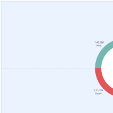
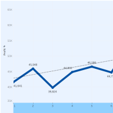
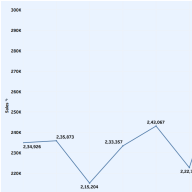
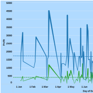
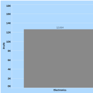
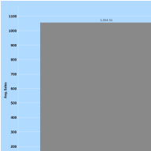
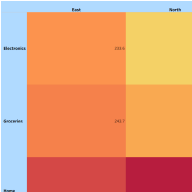

# Regional Retail Performance & Product Profitability Analysis

## Executive Summary
This commercial retail intelligence project investigates regional revenue distribution, seasonal profit trajectories, product category margin contributions, and transaction-level basket sizes across Indian retail markets.

Developed as part of the Postgraduate Business Data Visualization curriculum, this project answers targeted commercial questions regarding regional performance disparities, seasonal cash-flow predictability, and product assortment optimization.

---

## Analytical Visualizations & Dashboard Previews

### 1. Macro Regional Sales & Seasonality (Part 1)
| Total Sales by Region | Seasonal Profit Trend Over Months |
| :---: | :---: |
|  |  |
| **Monthly Revenue Velocity** | **Sales & Profit Trend Over Time** |
|  |  |

### 2. Micro Assortment & Product Profitability (Part 2)
| Top Products by Net Profit | Top Regions by Average Sales | Top Categories Profit by Region |
| :---: | :---: | :---: |
|  |  |  |

---

## Core Business Questions & Empirical Answers
### Question 1: Regional Sales Distribution
- **Objective:** Quantify revenue distribution across North, South, East, and West sales zones.
- **Data Finding:** Total sales reached **₹29,80,072**.
  - **East:** **₹7,80,759** (Highest — 26.2% of total revenue)
  - **West:** **₹7,42,388** (24.9%)
  - **North:** **₹7,29,139** (24.5%)
  - **South:** **₹7,27,786** (Lowest — 24.4%)
- **Insight:** Sales volume is remarkably balanced geographically, with the East region holding an edge due to urban consumer demand.

### Question 2: Profit Seasonality & Forecast Correlation
- **Objective:** Identify annual low/high margin inflection points.
- **Data Finding:**
  - **February:** Annual profit trough due to post-holiday retail lull.
  - **October:** Annual profit peak (**₹63,768** profit on **₹2,88,562** revenue), driven by festival shopping (Diwali/Navratri).
- **Insight:** Profit exhibits strong seasonal elasticity; marketing spend should be heavily front-loaded into Q3/Q4.

### Question 3: Assortment Margin Dynamics
- **Objective:** Identify top profit contributors across categories and regions.
- **Data Finding:**
  - Top 3 categories across all regions: **Electronics**, **Groceries**, and **Home Décor**.
  - **Home Décor (₹16,410)** and **Electronics (₹12,654)** achieve the highest profit margins.
  - Highest average transaction ticket: **South (₹1,089.63)** followed by **East (₹1,054.51)**.

---

## Dataset Architecture
- **Raw Datasets:** `Sales_Region.xlsx` (240 records), `Retail_Transactions.xlsx` (200 records), `shopping_behavior_updated.csv` (3,900 consumer records).
- **Cleaned Data:**
  - `clean_sales_region.csv` (Eliminated 5 blank trailing columns, standardized numeric metrics).
  - `clean_retail_transactions.csv` (Standardized dates and product category identifiers).
- **Workbooks:**
  - `Regional-Sales-Profitability.twbx` (Questions 1 & 2)
  - `Retail-Transactions-Profitability.twbx` (Question 3)

---

## Key Strategic Recommendations
1. **Capital Allocation for Festival Season:** Ensure inventory buffers are expanded in August/September to capture October's peak margin window.
2. **Assortment Rationalization:** Expand Home Décor floor space in Southern and Eastern stores to capitalize on higher average transaction values (₹1,089+).
3. **South Region Volume Expansion:** Implement targeted bundle discounts in the South region to convert its high average basket size into higher total market share.
