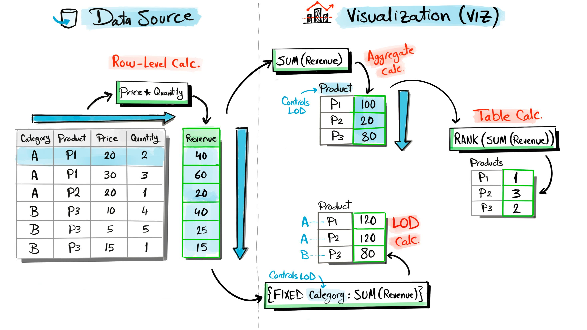

# Visual Analytics Gallery & Chart Selection Encyclopedia

## Executive Summary
This comprehensive gallery serves as an architectural reference and visual encyclopedia for advanced Tableau development, featuring **15 specialized workbooks**, **61 distinct chart types**, and complete implementations of modern calculation patterns (Level of Detail LOD expressions, Table Calculations, Parameter Actions, and Dynamic Tooltips).

Spanning 8 visualization taxonomies, this catalog demonstrates how to select, construct, and format the optimal visual representation for complex analytical questions, adhering to Stephen Few and Edward Tufte principles of cognitive load reduction and high data-ink ratios.

---

## Visual Taxonomies & Chart Classification

The master catalog workbook (`Visual-Analytics-Catalog.twbx`) organizes 61 visualizations across 8 core analytical intents:

```text
Visual Analytics Taxonomies
 ├── 1. Bar & Column (Standard, Stacked, Grouped, Diverging, Bullet, Waterfall)
 ├── 2. Change Over Time (Continuous Line, Stepped, Area, Sparklines, Dual-Axis, Slope)
 ├── 3. Correlation (Scatter Plot, Bubble Chart, Heatmaps, Scatter with Marginal Histograms)
 ├── 4. Distribution (Box & Whisker, Histograms, Quantile Plots, Density Curves)
 ├── 5. Magnitude (Lollipop, Packed Bubble, Dot Plots, Radar Charts)
 ├── 6. Part to Whole (Treemaps, Waffle Charts, Donut Charts, Stacked 100% Bar, Sunburst)
 ├── 7. Ranking (Bump Charts, Ranked Bar, Dumbbell Plots, Funnel Charts)
 └── 8. Spatial / Geographic (Symbol Maps, Filled Choropleth, Density Maps, Origin-Destination)
```

---

## Visual Catalog Previews

| Visual Catalog Architecture | Chart Selection Framework |
| :---: | :---: |
|  |  |
| **Data Modeling Foundations** | **Calculation Hierarchy** |
|  |  |

---

## Comprehensive Workbook Architecture (15 Modular Workbooks)

| Workbook Name | Core Architectural Topics Demonstrated |
| :--- | :--- |
| `Data Sources.twbx` | Multi-table physical joins (Inner, Left, Right, Full), unions, live connection vs. hyper extract tradeoffs. |
| `Metadata.twbx` | Dimensional vs. Measure roles, Discrete vs. Continuous data types, geographic role assignments. |
| `Renaming.twbx` | Field aliasing, custom header formatting, data cleaning at the presentation metadata layer. |
| `Organizing Data.twbx` | Hierarchical drills, static & dynamic grouping, combined sets, set actions for asymmetric drilling. |
| `Filtering Data.twbx` | Tableau Order of Operations, Context Filters, Dimension vs. Measure filters, Top-N filtering. |
| `Parameters.twbx` | Dynamic metric swappers, reference lines, what-if scenario forecasting and sensitivity modeling. |
| `Actions.twbx` | Interactive filter actions, Go-To-Sheet cross-navigation, URL web page embedding, parameter actions. |
| `Aggregate Calculations.twbx` | Aggregation rules, `ATTR()`, disaggregating data, handling nulls with `ZN()`. |
| `LOD Expressions.twbx` | `FIXED` (cohort analysis), `INCLUDE` (finer grain), `EXCLUDE` (broader grain) calculations. |
| `Row Level Calculations.twbx` | String manipulation (`SPLIT`, `LEFT`, `TRIM`), Date math (`DATEDIFF`, `DATEADD`), Logical branching. |
| `Table Calculations.twbx` | `RUNNING_SUM`, `PERCENT_OF_TOTAL`, `RANK_UNIQUE`, Addressing vs. Partitioning rules. |
| `Multi-Measures.twbx` | Blended axes, synchronized dual-axes, measure names & values architectures. |
| `Visual-Analytics-Catalog.twbx` | Master 61-chart visual encyclopedia across 8 dashboard categories. |
| `Dashboard.twbx` | Layout containers (tiled vs floating), inner/outer padding, responsive sizing modes, visual hierarchy. |
| `Sales & Customer Dashboards.twbx` | End-to-end commercial analytics capstone project with custom navigation menus. |

---

## Reference Datasets & Technical Documentation
- **Datasets:** Stored under `Data/raw/` (`small-dataset/` and `big-dataset/`), including `Customers.csv`, `Orders.csv`, `Products.csv`, `LOD.csv`, and `Product_prices.json`.
- **Architectural Documentation:** Stored under `Documentation/`:
  - `CHART_SELECTION_GUIDE.md`
  - `PROJECT_OVERVIEW.md`
  - `DATA_DICTIONARY.md`
  - Cheat sheets and visual reference slides in `cheat_sheets/`
