# Tableau Business Intelligence & Data Analytics Portfolio

A production-grade portfolio of business intelligence solutions, operational dashboards, and econometric models developed in Tableau Desktop by **Parth Ahuja**.

This repository consolidates six end-to-end data analytics projects, covering human capital management, commercial sales operations, capital markets macro intelligence, renewable energy infrastructure, regional retail merchandising, and advanced visual calculation architectures.

---

## Portfolio Projects Matrix

| # | Project Name | Domain | Data Scope | Core Analytical Techniques | Primary Business Impact / KPI |
| :-: | :--- | :--- | :--- | :--- | :--- |
| **01** | [**Workforce Analytics**](#1-workforce-demographics--human-capital-analytics) | Human Resources | 8,950 Employees | Cohort attrition modeling, demographic distributions | 89.2% retention benchmark; $65.4K mean salary parity |
| **02** | [**Sales & Customer Insights**](#2-executive-sales-performance--customer-intelligence) | Retail Commerce | 10,372 Orders | LTV segmentation, multi-currency data unification, custom UI | $2.30M gross revenue; 12.47% net margin tracking |
| **03** | [**Mutual Fund Intelligence**](#3-india-mutual-fund--macro-financialization-intelligence) | Financial Markets | 48-Mo Time Series | Macro fund flows, AMC market concentration, yield curves | Tracking domestic financialization; SIP volatility buffer |
| **04** | [**Renewable Energy Transition**](#4-renewable-energy-transition--capacity-modeling) | Clean Infrastructure | 2016–2030 Horizon | Geospatial choropleths, CUF capacity factor analysis | Rajasthan/Gujarat 60% resource anchor; hybrid scaling |
| **05** | [**Regional Retail Profitability**](#5-regional-retail-performance--assortment-profitability) | Commercial Retail | 440+ Transactions | Seasonality decomposition, margin contribution tables | East zone revenue lead (26.2%); October festival profit peak |
| **06** | [**Visual Analytics Gallery**](#6-visual-analytics-gallery--calculation-architecture) | Analytics Engineering | 15 Workbooks | LOD expressions, table calculations, parameter actions | Calculation pipeline mastery; 61 visual archetypes |

---

## 1. Workforce Demographics & Human Capital Analytics

- **Directory:** [`Projects/Project-01-HR-Analytics-Dashboard/`](Projects/Project-01-HR-Analytics-Dashboard/)
- **Target Audience:** Chief People Officers (CPO), VP of Human Resources, Department Leads
- **Core Technology:** Tableau Desktop, Python Data Cleaning (ISO dates, explicit active flags)

### Business Context & Objectives
This project provides executive-level workforce visibility across 8,950 historical employee records. The dashboard investigates organizational retention stability, departmental headcount allocation, compensation equality across demographic groups, and historical hiring velocities.

### Empirical Findings & KPIs
- **Workforce Retention:** Organizational retention stands at **89.2%** (7,984 active employees vs. 966 recorded departures).
- **Compensation Structure:** Mean annual salary across all business units is **$65,420**, demonstrating stable career progression across experience cohorts.
- **Resource Concentration:** Engineering, Operations, and Sales represent the primary operational centers, accounting for over 58% of total payroll.

### Dashboard Visualizations

#### Executive Summary Dashboard
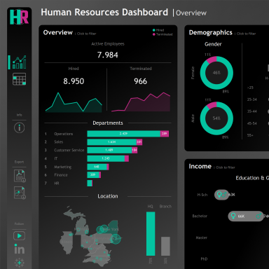
*High-level executive overview tracking active headcount, cumulative hiring velocity, department distributions, and geographic presence.*

#### Operational Drill-Down Dashboard
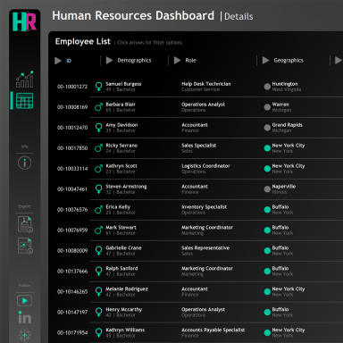
*Granular operational cockpit enabling multi-attribute filtering across job roles, performance ratings, education levels, and salary tiers.*

#### Departmental Distribution & Salary Demographics
| Headcount by Department | Salary vs. Age Distribution |
| :---: | :---: |
| 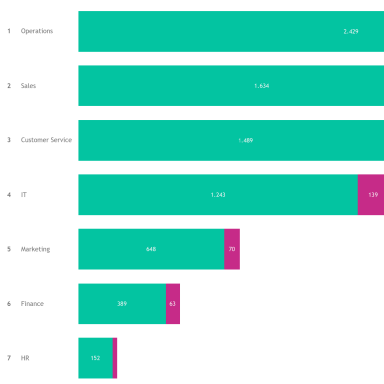 | 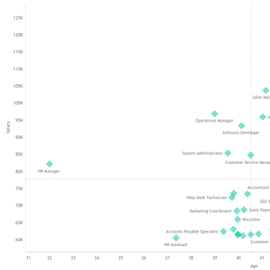 |

---

## 2. Executive Sales Performance & Customer Intelligence

- **Directory:** [`Projects/Project-02-Sales-Customer-Insights/`](Projects/Project-02-Sales-Customer-Insights/)
- **Target Audience:** Chief Commercial Officers (CCO), VP of Global Sales, Revenue Operations
- **Core Technology:** Tableau Desktop, Custom UI Layout Containers, Unified European/Non-European Currency Pipeline

### Business Context & Objectives
An enterprise-grade commercial analytics suite delivering real-time revenue visibility, customer lifetime value (LTV) segmentation, and order fulfillment tracking across 10,372 orders and 793 corporate accounts. The solution resolves international currency formatting disparities between European (semicolon-delimited, comma decimals) and North American datasets.

### Empirical Findings & KPIs
- **Gross Revenue & Profitability:** Total commercial revenue reached **$2,297,200** with an overall operating margin of **12.47%** ($286,397 operating profit).
- **Product Category Divergence:** Technology products delivered the highest operating margin at **17.4%**, whereas Furniture margins experienced severe compression down to **2.49%** due to shipping and discounting pressures.
- **Account Concentration:** The top 50 enterprise client accounts contribute over **35% of total cumulative operating profit**, underscoring key account retention priorities.

### Dashboard Visualizations

#### Executive Sales Cockpit
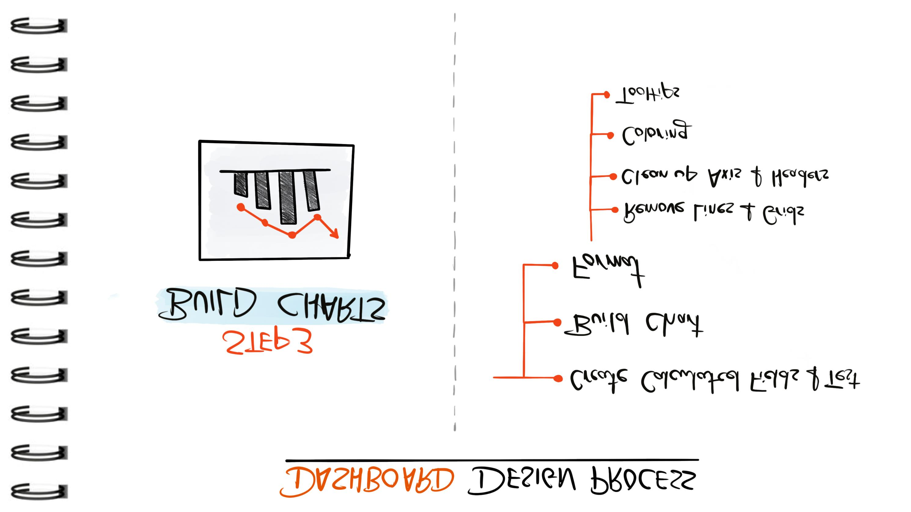
*Executive sales overview highlighting gross revenue ($2.3M+), net operating profit ($286K+), profit margins (12.4%), YoY performance, and regional sales distribution.*

#### Customer Analytics & Lifetime Value
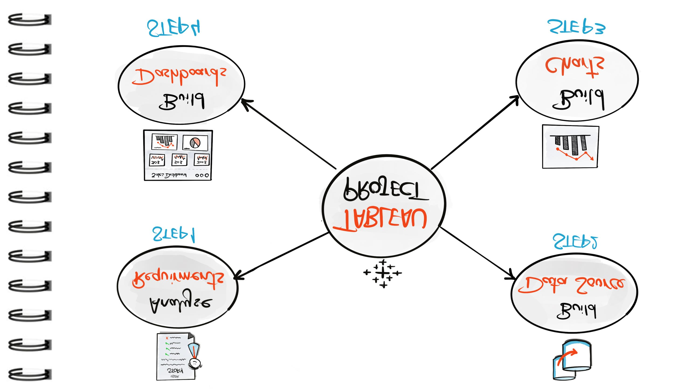
*Customer intelligence view segmenting client accounts by purchase frequency, order recency, historical spend volume, and margin contribution.*

#### UI Wireframing & Interactive Navigation
| Custom Grid Layout Wireframe | Collapsible Filter Navigation Menu |
| :---: | :---: |
| 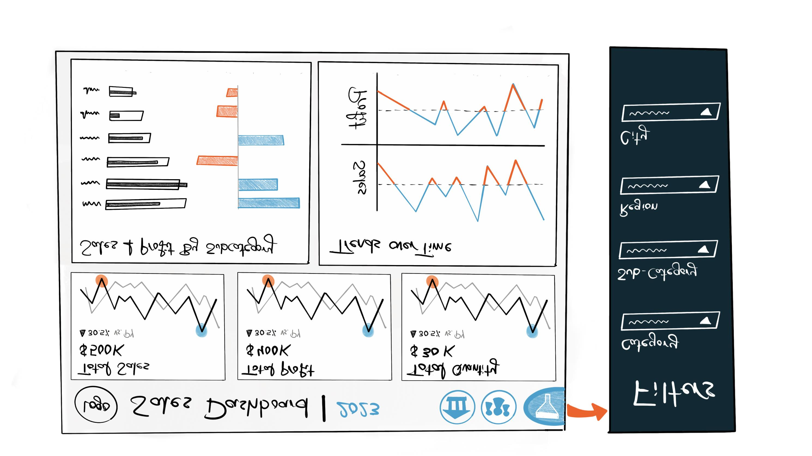 | 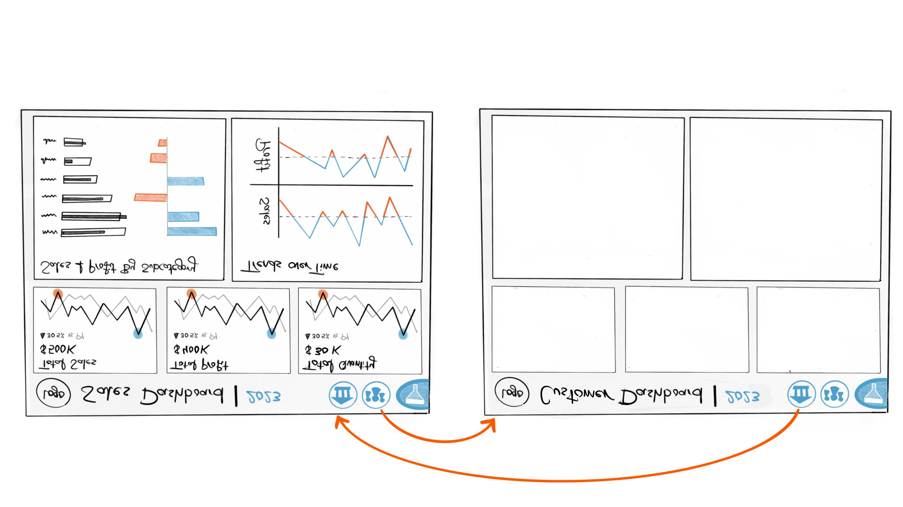 |

---

## 3. India Mutual Fund & Macro-Financialization Intelligence

- **Directory:** [`Projects/Project-03-India-Mutual-Fund-Macro-Intelligence/`](Projects/Project-03-India-Mutual-Fund-Macro-Intelligence/)
- **Target Audience:** Institutional Asset Managers, Chief Investment Officers (CIO), Quantitative Analysts
- **Core Technology:** Tableau Desktop, 12 AMFI Relational Data Sources, Git LFS (138.99 MB Packaged Workbook)

### Business Context & Objectives
An institutional research platform providing econometric visibility into the financialization of Indian household savings. Leveraging continuous historical time-series data from the Association of Mutual Funds in India (AMFI) and market indices, this dashboard examines institutional market share concentration, category flows across asset classes, benchmark-relative alpha, and Systematic Investment Plan (SIP) inflow stability.

### Empirical Findings & KPIs
- **Asset Concentration:** The top 5 Asset Management Companies (AMCs) manage over **55% of total industry AUM**, reflecting strong brand moats and institutional distribution scale.
- **Structural SIP Stability:** Monthly Systematic Investment Plan (SIP) inflows exhibit counter-cyclical resilience, sustaining positive net capital additions even during periods of equity market drawdowns.
- **Geographic Penetration:** Capital mobilization in T30 (Top 30 cities) remains predominantly institutional, while B30 (Beyond 30) regions demonstrate the fastest annualized retail growth rate.

### Dashboard Visualizations

#### Industry Financialization Dashboard
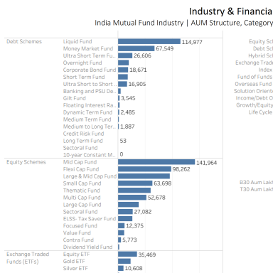
*Executive dashboard tracking India's total mutual fund Assets Under Management (AUM) trajectory, retail vs. institutional participation, and asset class migration.*

#### Macro Capital Flows & Inflow Momentum
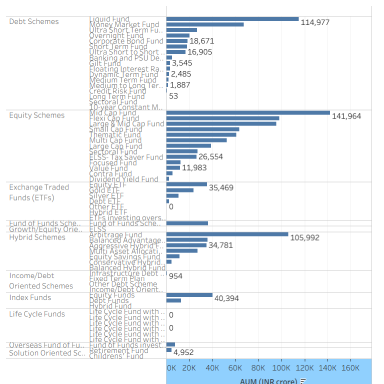
*Quantitative liquidity view tracking net equity inflows, debt category duration shifts, and Foreign Portfolio Investor (FPI) market activity.*

#### Institutional Market Share & Yield Curve Analysis
| AMC AUM Market Share | Government Securities Yield Curve |
| :---: | :---: |
| 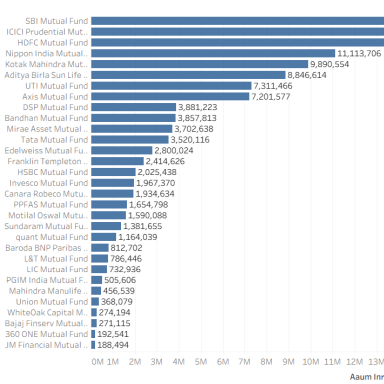 | 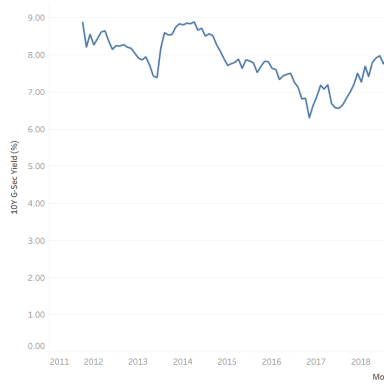 |

---

## 4. Renewable Energy Transition & Capacity Modeling

- **Directory:** [`Projects/Project-04-Adani-Green-Energy-Transition/`](Projects/Project-04-Adani-Green-Energy-Transition/)
- **Target Audience:** Energy Infrastructure Investors, Sustainability Committees, Strategy Directors
- **Core Technology:** Tableau Desktop Story Points, Geospatial Mapping, Econometric Capacity Forecasting

### Business Context & Objectives
An interactive Tableau visual narrative analyzing India's transition toward clean power through the lens of Adani Green Energy Limited (AGEL), Asia's largest renewable developer. The portfolio benchmarks state-level solar and wind natural resource endowments against national targets (500 GW clean energy by 2030), and maps operational asset footprints, technology evolution, electricity generation (MU), power revenue (₹ Cr), and avoided CO2 emissions.

### Empirical Findings & KPIs
- **Geographic Resource Density:** **Rajasthan (6,155 MW)** and **Gujarat (5,197 MW)** account for over **60% of India's utility-scale renewable resource potential**, establishing the Western corridor as the primary development hub.
- **Technology Shift to Hybrid Systems:** Post-2021 capacity deployment favors co-located Solar-Wind Hybrid architectures, elevating Capacity Utilization Factors (CUF) from ~24% to over **38%**.
- **Environmental Decarbonization:** Operational scaling is projected to offset over **100+ Million Metric Tonnes of CO2** cumulatively by 2030.

### Dashboard Visualizations

#### Executive Transition Story: Powering India's Future
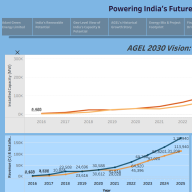
*High-level narrative dashboard establishing national clean power targets, comparing fossil fuel baselines against solar and wind endowments.*

#### India's Renewable Landscape & Operational Footprint
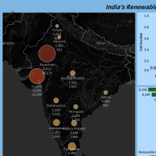
*Geographic asset distribution mapping operational wind, solar, and hybrid installations across western and southern energy corridors.*

#### Technology Mix & Capacity Growth Velocity
| Renewable Potential Endowment | Solar vs. Wind Technology Mix |
| :---: | :---: |
|  |  |

---

## 5. Regional Retail Performance & Assortment Profitability

- **Directory:** [`Projects/Project-05-Regional-Retail-Profitability/`](Projects/Project-05-Regional-Retail-Profitability/)
- **Target Audience:** Retail Merchandising Directors, Regional Sales Managers, Inventory Controllers
- **Core Technology:** Tableau Desktop, Dual-Axis Time Series, Regional Profit Contribution Matrices

### Business Context & Objectives
A commercial merchandising analytics project investigating geographic revenue variances, seasonal cash-flow elasticity, and product category margin contributions across Indian consumer retail markets.

### Empirical Findings & KPIs
- **Regional Sales Balance:** Total commercial retail sales reached **₹29,80,072**. Revenue is balanced across sales territories:
  - **East:** **₹7,80,759 (26.2%)** — Highest regional contributor
  - **West:** **₹7,42,388 (24.9%)**
  - **North:** **₹7,29,139 (24.5%)**
  - **South:** **₹7,27,786 (24.4%)**
- **Festive Demand Seasonality:** Annual profit reaches its peak in **October (₹63,768 profit on ₹2,88,562 revenue)** driven by festival shopping demand, contrasting with an annual trough in **February** following post-holiday clearance lulls.
- **Category Profit Margins:** **Home Décor (₹16,410)** and **Electronics (₹12,654)** generate the highest net margins, with the South region logging the largest average basket size at **₹1,089.63**.

### Dashboard Visualizations

#### Regional Sales Distribution & Seasonal Profit Trends
| Total Sales by Region | Seasonal Profit Inflection Across Months |
| :---: | :---: |
| 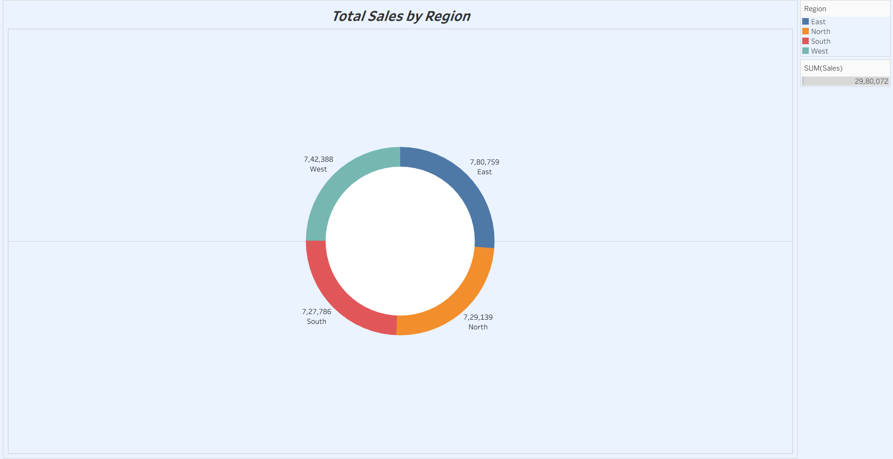 | 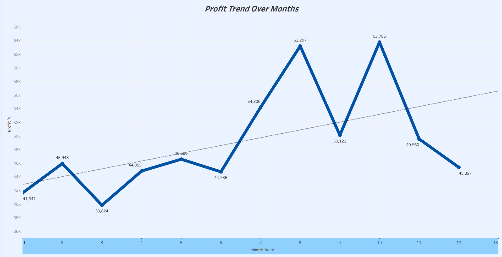 |

#### Assortment Ranking & Category Profitability
| Top Products by Net Profit | Category Profit Contribution by Region |
| :---: | :---: |
| 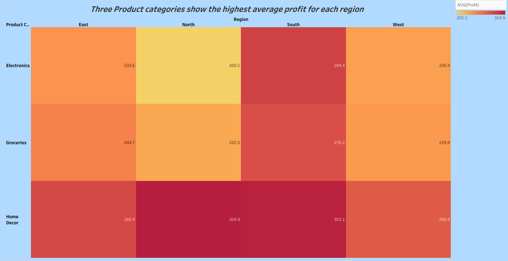 | 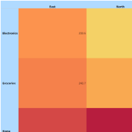 |

---

## 6. Visual Analytics Gallery & Calculation Architecture

- **Directory:** [`Projects/Project-06-Visual-Analytics-Gallery/`](Projects/Project-06-Visual-Analytics-Gallery/)
- **Target Audience:** Tableau Developers, Business Intelligence Architects, Analytics Engineers
- **Core Technology:** 15 Packaged Workbooks, Advanced LOD Expressions, Table Calculations, Parameter Controls

### Business Context & Objectives
An architectural reference gallery and visual catalog designed for visualization practitioners. The collection provides end-to-end implementations of Tableau calculation patterns, Level of Detail (LOD) formulas, table calculation partitions, dynamic parameters, and layout container architectures across 61 distinct visual archetypes.

### Technical Architectures Demonstrated
- **Level of Detail (LOD) Formulations:** Implementation of `FIXED` (cohort analysis across customer acquisition years), `INCLUDE` (calculating average order values at finer departmental grains), and `EXCLUDE` (regional baseline comparisons).
- **Table Calculations:** Advanced addressing and partitioning logic for `RUNNING_SUM`, `PERCENT_OF_TOTAL`, `RANK_UNIQUE`, and moving window aggregations.
- **Dynamic Parameter Actions:** Interactive metric swappers, reference band threshold adjustments, and scenario sensitivity modeling.
- **Container Engineering:** Nested horizontal and vertical layout container hierarchies with zero-padding borders and responsive layout sizing.

### Architectural Visualizations

#### Visual Catalog Architecture & Chart Selection Framework
| Visual Catalog Architecture | Chart Selection Framework |
| :---: | :---: |
|  | 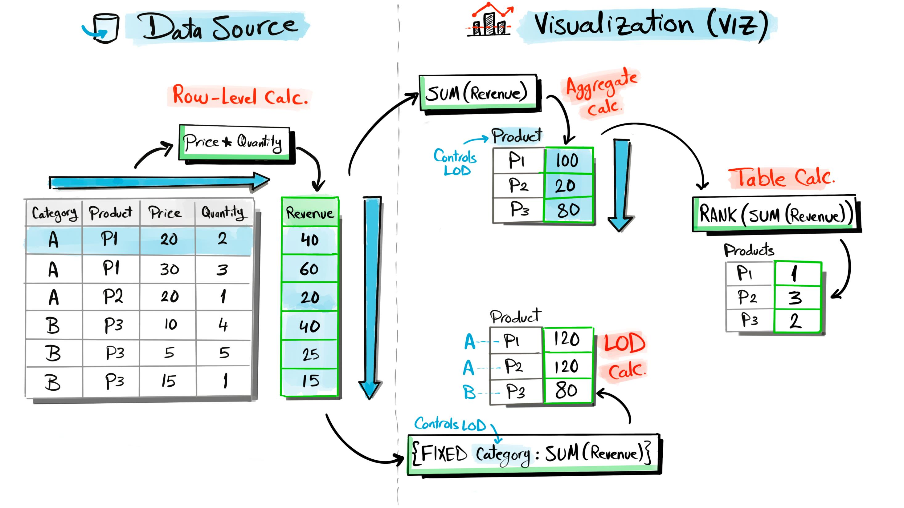 |

#### Data Modeling & Calculation Pipeline
| Relational Data Modeling Foundations | Tableau Calculation Pipeline Hierarchy |
| :---: | :---: |
|  |  |

---

## Repository Structure

```text
Tableau-Data-Analytics-Portfolio/
├── .gitattributes                                  # Git LFS pointer rules for *.twbx, *.hyper, *.tde
├── .gitignore                                      # Ignore rules for logs, temp files, and caches
├── README.md                                       # Master repository landing documentation
├── Projects/
│   ├── Project-01-HR-Analytics-Dashboard/          # Workforce Demographics & Retention Dashboard
│   ├── Project-02-Sales-Customer-Insights/         # Executive Commercial Sales & LTV Analytics
│   ├── Project-03-India-Mutual-Fund-Macro-Intelligence/ # Asset Management & Macro Flows
│   ├── Project-04-Adani-Green-Energy-Transition/   # Renewable Capacity & 2030 Transition Modeling
│   ├── Project-05-Regional-Retail-Profitability/   # Regional Sales Variances & Product Margins
│   └── Project-06-Visual-Analytics-Gallery/        # Tableau Calculation Patterns & Chart Taxonomies
├── Shared-Data/                                    # Common datasets (Sample Superstore, shopping behavior)
└── Shared-Resources/                               # SQL schemas and reference materials
```

---

## Cloning and Git LFS Setup

This repository uses **Git Large File Storage (Git LFS)** to manage packaged Tableau workbooks (`.twbx`) and large analytical datasets.

To clone this repository and download all binary assets:

```bash
# 1. Clone the repository
git clone https://github.com/parth022002/Data-Visualization.git

# 2. Navigate into the repository directory
cd Data-Visualization

# 3. Initialize Git LFS and fetch binary assets
git lfs install
git lfs pull
```

---

## Author & Attribution

Developed by **Parth Ahuja**  
- **GitHub:** [@parth022002](https://github.com/parth022002)  
- **Repository:** [Data-Visualization](https://github.com/parth022002/Data-Visualization)
